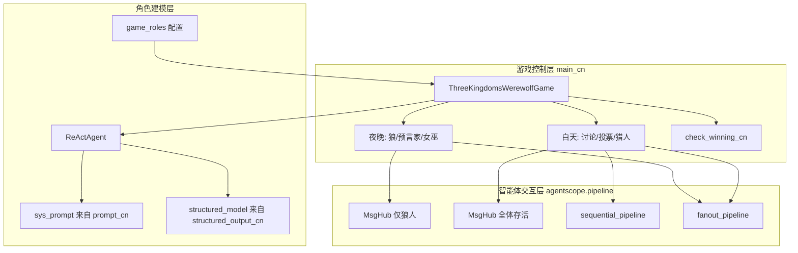

# AgentScope 三国狼人杀 · 学习笔记

> 主题：Hello-Agents 第六章 AgentScopeDemo  
> 更新日期：2026-08-02  
> 对应目录：`code/chapter6/AgentScopeDemo/`

---

## 1. 本轮目标

读懂并用自己的话解释：**AgentScope 如何用「消息 + 管道」编排多智能体狼人杀**，而不是只记住「有个三国狼人杀 Demo」。

掌握后你应能：

1. 画出本 Demo 的三层架构，并指出每层对应哪些文件/类
2. 说明 `MsgHub` / `sequential_pipeline` / `fanout_pipeline` 各自解决什么问题
3. 解释结构化输出（Pydantic）如何把「游戏规则」变成「可校验的模型输出」
4. 对比 AutoGen（对话驱动）与 AgentScope（消息/工程驱动）的选型差异

---

## 2. 来源资料

### 事实依据（优先）

| 来源 | 用途 |
|------|------|
| 本目录源码：`main_cn.py` 等 6 个文件 | 以代码为准的行为与 API 用法 |
| [Hello-Agents 第六章 §6.3](../../../../docs/chapter6/第六章%20框架开发实践.md) | 教材对设计理念与案例的讲解 |
| [AgentScope Pipeline / MsgHub 文档](https://doc.agentscope.io/zh_CN/tutorial/task_pipeline.html) | 官方对编排原语的定义 |
| [AgentScope Orchestration](https://docs.agentscope.io/v1/building-blocks/orchestration) | MsgHub / Sequential / Fanout 参数说明 |
| [AgentScope Agent / ReActAgent](https://docs.agentscope.io/building-blocks/agent) | 智能体能力与结构化输出 |

### 建议判断（教学取舍）

- 学习顺序：先跑通主循环 → 再抠 MsgHub/Pipeline → 最后改角色与提示词
- 本 Demo 的价值在「编排范式」，不在「AI 狼人杀水平有多高」
- 教材文字与当前代码有少量术语漂移（见 §7），以代码为准

---

## 3. 一句话总览

**游戏控制层推进昼夜流程；交互层用 MsgHub/Pipeline 决定「谁和谁说话、串行还是并行」；角色层用 ReActAgent + 系统提示词 + Pydantic 结构化输出，让每个三国人物按规则行动。**

---

## 4. 文件地图（先建立目录感）

```
AgentScopeDemo/
├── main_cn.py              # 游戏主循环：昼夜、阵营阶段、胜负
├── prompt_cn.py            # 双重身份系统提示词（游戏角色 × 三国人物）
├── game_roles.py           # 角色能力、性格、人数配置表
├── structured_output_cn.py # 讨论/投票/女巫/预言家/猎人等 Pydantic 模型
├── utils_cn.py             # 主持人、投票统计、胜负判定、辅助函数
├── requirements.txt        # agentscope==1.0.2
└── README.md               # 运行说明与架构摘要
```

| 文件 | 职责一句话 | 对应学习点 |
|------|------------|------------|
| `main_cn.py` | 编排整局游戏 | 异步主循环、阶段拆分 |
| `utils_cn.py` | 主持人公告 + 规则工具 | `AgentBase` 自定义、胜负/计票 |
| `structured_output_cn.py` | 约束「能输出什么」 | `structured_model=` |
| `prompt_cn.py` | 约束「该怎么想、怎么说话」 | Prompt 与规则的边界 |
| `game_roles.py` | 配置表，少写 if-else | 数据驱动角色设计 |

---

## 5. 核心概念

### 5.1 消息驱动（Message-Driven）

- **是什么**：智能体之间不直接「函数互调」，而是发/收 `Msg`（含 `name` / `content` / `role` / `metadata`）。
- **为什么存在**：解耦时间与位置，便于并发、广播、事后追踪。
- **在本 Demo**：主持人 `GameModerator.announce()` 发系统公告；玩家发言经 MsgHub 广播；结构化决策常落在 `msg.metadata`。

### 5.2 MsgHub（临时通信频道）

- **是什么**：异步上下文管理器；参与者之一回复时，其他人通过 `observe` 收到消息。
- **解决什么**：狼人夜谈（仅狼人）、白天公议（全体存活）需要不同「可见范围」。
- **关键参数**（官方）：`participants`、`announcement`、`enable_auto_broadcast`；可用 `set_auto_broadcast(False)` 在投票前关掉广播，避免投票理由互相污染。

### 5.3 Pipeline（编排语法糖）

| API | 模式 | 本 Demo 用法 |
|-----|------|--------------|
| `sequential_pipeline` | 按顺序一人接一人 | 白天自由讨论：每人发言一轮 |
| `fanout_pipeline` | 同一输入分发给多人 | 狼人击杀投票、白天淘汰投票 |

注意：`enable_gather=False` 时更偏顺序收集；`True` 时用 `asyncio.gather` 真正并发。本 Demo 投票处多为 `False`，优先「稳定收集」而非极致并行。

### 5.4 ReActAgent + 结构化输出

- 玩家用 `ReActAgent`（非教材里偶见的旧称 DialogAgent）。
- 调用形如：`await agent(structured_model=SomeModel)`。
- Pydantic 把「投票对象必须是存活玩家名」等规则变成 schema（如 `Literal[玩家名...]`）。

### 5.5 双重角色建模

- **游戏角色**：狼人 / 预言家 / 女巫 / 猎人 / 村民 → 决定权限与胜利条件。
- **三国人物**：刘备、曹操… → 决定语气与策略风格。
- 二者在 `ChinesePrompts.get_role_prompt(role, character)` 中拼接。

### 5.6 主持人（Moderator）

`GameModerator` 继承 `AgentBase`，负责公告与日志，本身不参与投票博弈。把「系统旁白」做成 Agent，是为了统一走消息打印与日志通道。

---

## 6. 结构框架



### 主循环（`run_game`）心智模型

```
setup_game
  → for round in 1..MAX_GAME_ROUND:
       night_announcement
       werewolf_phase → killed?
       seer_phase
       witch_phase → final_killed / poisoned
       update_alive + death_announcement
       若胜负已定 → 结束
       day_phase → voted_out
       hunter_phase
       update_alive
       若胜负已定 → 结束
```

---

## 7. 关键代码路径精读

### 7.1 创建玩家：身份注入

```python
# main_cn.py · create_player
agent = ReActAgent(
    name=name,
    sys_prompt=ChinesePrompts.get_role_prompt(role, character),
    model=DashScopeChatModel(model_name="qwen-max", ...),
    formatter=DashScopeMultiAgentFormatter(),
)
await agent.observe(await self.moderator.announce(...身份确认...))
```

要点：`observe` =「记入记忆但不要求立刻回复」；适合发身份、查验结果等私有信息。

### 7.2 狼人阶段：私密频道 + 讨论 + 扇出投票

1. `MsgHub(self.werewolves, enable_auto_broadcast=True)` → 狼人间互相可见  
2. 多轮 `await wolf(structured_model=DiscussionModelCN)` → 协商  
3. `set_auto_broadcast(False)` → 投票互不可见  
4. `fanout_pipeline(..., WerewolfKillModelCN)` → 收集击杀目标  
5. `majority_vote_cn` → 多数决；无效票随机兜底  

### 7.3 预言家 / 女巫：点对点信息

- 预言家：结构化选目标 → 主持人查 `self.roles` → `observe` 告知好人/狼人  
- 女巫：先 `observe` 死亡信息 → 再输出 `WitchActionModelCN` → 代码侧扣解药/毒药库存  

### 7.4 白天：顺序讨论 + 扇出投票

- `sequential_pipeline(self.alive_players)`：公议一轮  
- `fanout_pipeline` + `get_vote_model_cn(alive)`：票面必须是当前存活人名  

### 7.5 胜负（`utils_cn.check_winning_cn`）

- 存活狼人数 = 0 → 好人胜  
- 存活狼人数 ≥ 好人数 → 狼人胜  

---

## 8. 教材 vs 当前代码（避免踩坑）

| 点 | 教材表述 | 当前代码 |
|----|----------|----------|
| 玩家 Agent 类型 | 常写 DialogAgent | `ReActAgent` |
| 依赖版本 | 概念讲解 | `agentscope==1.0.2` |
| 提示词 | 强调「不要调用工具」等 | `prompt_cn.py` 偏讨论 JSON；实际以各阶段 `structured_model` 为准 |
| 容错 | 教材示例有 try/except 默认模型 | 代码多对 `metadata is None` 做跳过/随机/弃票 |

**学习策略**：概念跟教材，API 跟源码与 [官方 Pipeline 文档](https://doc.agentscope.io/zh_CN/tutorial/task_pipeline.html)。

---

## 9. 与同章其他框架对比（选型直觉）

| 维度 | AutoGen | AgentScope（本 Demo） | CAMEL | LangGraph |
|------|---------|----------------------|-------|-----------|
| 协作隐喻 | 对话组 / Team | 消息中心 + 管道 | 角色扮演涌现 | 显式状态图 |
| 本场景优势 | 快速对话协作 | 私密频道、并发投票、工程化 | 轻量双人角色戏 | 强可控状态机 |
| 典型成本 | 流程偶发难控 | 需熟悉 async / 编排 API | 重提示词 | 需手写节点边 |

狼人杀里「夜里只有狼人听见」非常适合 MsgHub 的参与者子集；这是选 AgentScope 讲这个案例的关键原因。

---

## 10. 常见混淆点

1. **MsgHub ≠ 永久聊天室**  
   它是 `async with` 作用域内的临时广播域，出了上下文就不再自动广播。

2. **`observe` ≠ `await agent(...)`**  
   - `observe`：只看不说  
   - `await agent(...)`：思考并产生回复（可带 structured_model）

3. **结构化输出 ≠ 提示词里的 JSON 说明**  
   真正强约束来自 `structured_model=` + Pydantic；`prompt_cn.py` 里的 JSON 示例主要服务讨论阶段心智，不宜当成唯一真源。

4. **`fanout` 的 gather 开关**  
   `enable_gather=True` 才是典型「同时收集」；本 Demo 常关，行为上更像稳定的多路调用。

5. **主持人不是神职玩家**  
   `GameModerator` 不进 `alive_players`，不参与胜负人数统计。

---

## 11. 运行与调试备忘

```bash
cd code/chapter6/AgentScopeDemo
# 建议使用项目/课程 venv
pip install -r requirements.txt
# .env 中设置 DASHSCOPE_API_KEY=sk-...
python main_cn.py
```

常见问题：

- 缺 `DASHSCOPE_API_KEY` → `main()` 直接退出  
- 结构化输出偶发 `metadata is None` → 代码已有跳过/随机/弃票兜底  
- 费用与耗时：每轮多次 LLM 调用，6 人局也会产生不少 token  

---

## 12. 我的理解（可自行改写）

- 我现在能怎么解释：  
  > AgentScope 把「谁在什么范围里说话」做成 MsgHub，把「串行发言 / 并行决策」做成 Pipeline，再用结构化输出钉住投票与技能动作；游戏类只负责推进昼夜与改存活列表。

- 我还没搞清楚什么：（学习时填写）  
  - [ ] MsgHub 内部如何调用 `observe`  
  - [ ] ReActAgent 在无 Toolkit 时仍叫 ReAct 的原因  
  - [ ] 分布式部署时消息顺序如何保证（课后思考题）

---

## 13. 下一步

见同目录：

- `agentscope-werewolf-learning-plan.md` — 3 日学习计划  
- `agentscope-werewolf-project-brief.md` — 动手改 Demo 的任务书  
- `agentscope-werewolf-mastery-check.md` — 掌握度自测  

建议下一动作（约 45–60 分钟）：只读 `werewolf_phase` + `day_phase`，用纸笔画「消息从谁到谁」。

---

## 14. 通俗版：AgentScope 整体架构（追加 2026-08-02）

一句话：AgentScope 像一套「多智能体操作系统」——底下是零件（消息/模型/工具/记忆），中间是能干活的员工（Agent），再往上是会议室和流水线（MsgHub/Pipeline），最顶上是能上生产环境的运行与调试工具。

四层从下到上：

1. 基础组件：Msg、Memory、Model API、Tool  
2. 智能体基础设施：ReActAgent、钩子、异步与实时控制  
3. 多智能体协作：MsgHub + Pipeline（本 Demo 最该吃透的一层）  
4. 开发与部署：Runtime / Studio（工程化能力，入门可后看）

核心心智：智能体之间主要靠「寄信」（消息），而不是互相直接打电话（硬函数耦合）；MsgHub 决定「这封信谁能看见」，Pipeline 决定「大家按什么队形发言/决策」。
