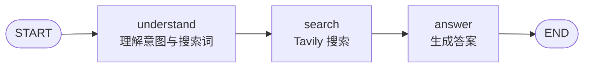
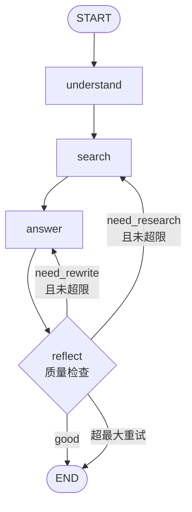
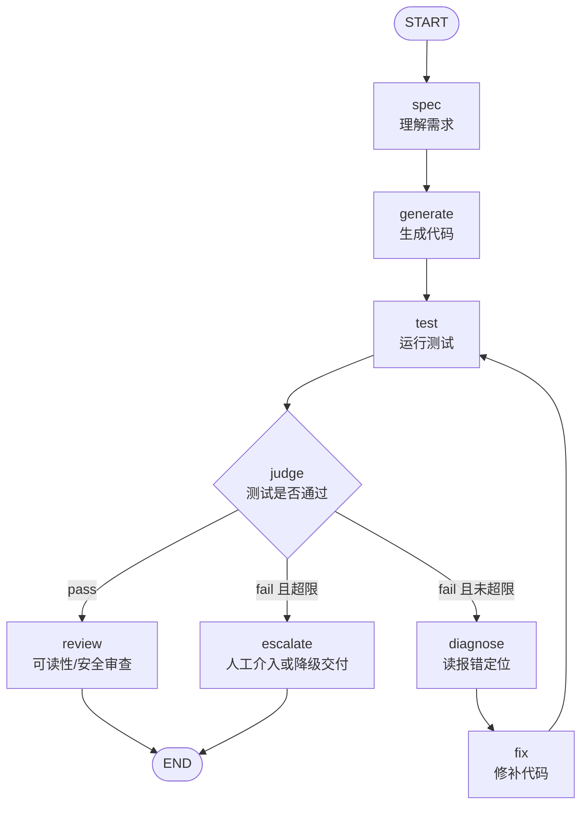

# 第六章习题详解：框架开发实践

> 基于教材《第六章 框架开发实践》习题，用通俗语言梳理答案与设计思路。  
> 来源：教材正文 + CAMEL 官方 Workforce 文档（docs.camel-ai.org）。

---

## 总览：先抓住一条主线

四个框架可以记成一句话：

| 框架 | 一句话定位 |
|------|-----------|
| AutoGen | 用「群聊对话」让多角色协作 |
| AgentScope | 用「消息中心 + 工程化」做可上线的多智能体 |
| CAMEL | 用「角色扮演 + 提示」让协作自然涌现 |
| LangGraph | 用「状态机 / 有向图」显式控制每一步 |

本章最核心的权衡：**涌现式协作** vs **显式控制**，再加上 AgentScope 强调的 **工程化**。

---

## 习题 1：框架对比与设计哲学

### 1.1 选两个框架深入对比（以 AutoGen vs LangGraph 为例）

也可换成 CAMEL vs AgentScope，这里选最容易形成对照的一对。

#### 协作模式

- **AutoGen**：像开圆桌会议。产品经理、工程师、审查员轮流发言，任务推进靠「对话历史」自然传递。
- **LangGraph**：像画流程图。先理解、再搜索、再回答；每一步是图上的节点，跳转靠边（尤其是条件边）。

类比：AutoGen 是「大家商量着办」；LangGraph 是「按 SOP 办事」。

#### 控制方式

- **AutoGen**：弱控制、强角色。你主要定义「谁是谁、职责是什么」，发言顺序可用 `RoundRobinGroupChat` 固定，但具体说什么仍由 LLM 决定，存在跑偏风险。
- **LangGraph**：强控制、强状态。你必须定义 `State`、节点函数、边与条件边；下一步去哪几乎完全由你写死的逻辑决定。

#### 适用场景

| 维度 | AutoGen 更合适 | LangGraph 更合适 |
|------|----------------|------------------|
| 任务形态 | 开放协作、多角色讨论、创意迭代 | 固定流程、可审计、要循环修正 |
| 可预期性 | 中等，依赖对话质量 | 高，流程可预测 |
| 开发成本 | 上手快，角色提示写得好就能跑 | 前期样板代码多，但长期可控 |

#### 补充：CAMEL vs AgentScope（快速对照）

| 维度 | CAMEL | AgentScope |
|------|-------|------------|
| 协作模式 | 双角色（或 Workforce 多工人）深度对话 | MsgHub 消息路由 + Pipeline |
| 控制方式 | 提示引导为主，终止靠标志位 | 消息驱动 + 结构化输出约束 |
| 适用场景 | 创作、研究、深度讨论 | 游戏、仿真、分布式、高并发工程场景 |

### 1.2 「涌现式协作」与「显式控制」怎么理解？

**涌现式协作**（AutoGen / CAMEL）：

- 你只规定角色、目标和少量规则。
- 复杂协作行为从多轮对话中「自己长出来」。
- 优点：灵活、像真人团队、少写流程代码。
- 缺点：难预测、难调试、可能循环或跑题。

**显式控制**（LangGraph）：

- 你事先画好「走到哪、在什么条件下回头」。
- 优点：可靠、可审计、易插入人工审核。
- 缺点：缺少开放式惊喜，简单任务也偏重。

记一句口诀：

> 要惊喜和创造力 → 偏涌现；要合规和稳定 → 偏显式。  
> 要上生产、要扩缩容 → 还得补工程化（AgentScope 这一维）。

---

## 习题 2：AutoGen 软件开发团队扩展

### 2.1 动态回退机制（需求变更时退回产品经理）

这段在回答一个工程问题：**AutoGen 里「按固定顺序轮流说话」的团队，怎么支持「审不过 / 需求变了 → 退回产品经理」？**

#### 问题本质：RoundRobin 只会往前，不会回头

现有 `RoundRobinGroupChat` 大致是：

```text
ProductManager → Engineer → CodeReviewer → UserProxy →（再循环）…
```

特点：

- 发言顺序写死，像传话筒按座位传
- **不管内容对不对**，下一棒总是名单里的下一个人
- 审查员说「需求理解错了」时，下一轮仍可能是 UserProxy，而不是 PM

所以「动态回退」不是加一句提示词就能从 RoundRobin 里自动长出来，而要改 **「谁下一个发言」的决策方式**。

#### 推荐思路（由易到难）

##### 1. 提示词协议（最轻）

**做法**：在各角色的 System Message 里约定「控制标签」，让模型输出时带上路由信号：

| 标签 | 含义 |
|------|------|
| `[HANDOFF:ProductManager]` | 需求变了 / 方案方向错 → 交给 PM |
| `[HANDOFF:Engineer]` | 代码有问题 / 审查不通过 → 交给工程师改 |
| `[APPROVE]` | 本阶段通过 → 进入下一环节 |

**类比**：员工写邮件时必须写「抄送：某某」，系统靠「抄送」决定下一个人，而不是按工号轮流。

**局限**：标签只是文本。若仍用纯 RoundRobin，标签只会被下一棒「看见」，**不会自动改顺序**。所以协议要配合下面的选择器（方案 2）才真正生效。

- 优点：改提示即可，几乎不写流程代码  
- 缺点：模型可能漏标、乱标；可靠性一般  

##### 2. 用 SelectorGroupChat 替代纯 RoundRobin（推荐入门落地）

把「永远下一个人」改成「看上一条消息再选人」。

伪逻辑：

```text
读上一条消息
  ├─ 含 [HANDOFF:ProductManager]           → 下一个 = PM
  ├─ 含 [HANDOFF:Engineer] / 审查失败      → 下一个 = Engineer
  ├─ 含 [APPROVE]                          → 按流水线前进（如 → QA / UserProxy）
  └─ 否则                                  → 默认下一阶段角色
```

**类比**：主持人听完发言再点名，而不是按座位号强制轮转。

与方案 1 的配套关系：

- 方案 1 = **说什么信号**（协议）
- 方案 2 = **谁听信号、怎么换人**（选择器）

- 优点：仍是一次群聊，能回退，代码量适中  
- 缺点：选择函数写不好会抖动（反复 PM↔Engineer）；要防死循环（加最大回退次数）  

##### 3. 外层状态机包一层（最稳、最像生产）

把协作拆成两层：

```text
外层：阶段机（谁说了算「现在在哪一关」）
内层：群聊（这一关内部怎么讨论）
```

阶段跳转示意：

```text
需求分析 → 编码 → 审查
   ↑         ↑      │
   └─────────┴──────┘  （审查失败 / 需求变更）
              ↓
            测试验收 → 结束
```

伪代码示意：

```python
# 伪代码：外层阶段机 + 内层群聊
phase = "pm_plan"
while phase != "done":
    if phase == "pm_plan":
        # 只让「需求分析」相关智能体跑一轮
        await team.run(...)
        phase = "engineer"          # 正常前进

    elif phase == "engineer":
        await team.run(...)
        phase = "review"

    elif phase == "review":
        result = await reviewer_decide(...)
        if result == "need_req_change":
            phase = "pm_plan"       # ★ 动态回退到 PM
        elif result == "need_fix":
            phase = "engineer"      # ★ 回退到工程师
        else:
            phase = "qa"            # 通过则前进

    elif phase == "qa":
        ...
```

要点：

- **回退发生在 `phase = ...`，不是发生在 RoundRobin 内部**
- 每次 `team.run` 可以只包含当前阶段需要的角色，甚至单角色任务
- 审查结果最好是结构化的（如 `need_req_change` / `need_fix` / `pass`），不要只靠自然语言猜

**类比**：公司用看板（阶段机），小组开会（群聊）只解决当前列的事；「打回需求」是把卡片拖回「需求分析」列，不是开会时硬插队乱说话。

- 优点：可控、可日志、可限次回退、易插人工审核  
- 缺点：要多写一层编排代码；「涌现式聊天」变少  

#### 具体场景串讲

场景：审查员发现「比特币页面还要支持法币切换」——这是需求变更，不是改两行 CSS。

| 方案 | 实际会发生什么 |
|------|----------------|
| 纯 RoundRobin | 审查员说完 → 还是轮到 UserProxy，PM 未必立刻接手 |
| 协议 + Selector | 审查员输出 `[HANDOFF:ProductManager]`，选择器下一人点 PM，PM 改需求后再交给 Engineer |
| 外层状态机 | `reviewer_decide()` 返回 `need_req_change`，`phase` 设回 `pm_plan`，明确重跑需求分析阶段 |

#### 怎么选（学习 / 做题建议）

1. **先懂痛点**：固定轮询 ≠ 真实研发流程（真实流程有返工）。  
2. **作业最小实现**：方案 1 标签 + 方案 2 Selector，就能演示「回退 PM」。  
3. **要稳、要交作业可演示**：上方案 3，阶段清晰、答辩好讲。  
4. **生产系统**：几乎一定是方案 3（或 LangGraph 一类显式图），标签协议可作辅助信号。

一句话总结：

> RoundRobin 解决「轮流说」；动态回退要解决「按结果选下一个」。  
> 轻量靠「标签 + 选择器」，稳妥靠「外层状态机管阶段、内层群聊管讨论」。

#### 方案 3 详解：外层状态机 + 内层阶段任务

##### 为什么要拆成两层？

| 层级 | 负责什么 | 不负责什么 |
|------|----------|------------|
| **外层状态机** | 现在处于哪一关、下一关去哪、何时回退、最多回退几次 | 具体怎么写需求/代码 |
| **内层（单角色或小群聊）** | 当前关卡内的 LLM 推理与产出 | 擅自决定跳到别的关 |

RoundRobin 把「讨论」和「流程」揉在一起，所以回退困难。  
方案 3 把流程上收到 Python 的 `while + phase`，LLM 只在关卡内干活——这就是「显式控制」。

##### 状态与转移（核心图）

```text
                 ┌──────────────────────────────────────┐
                 │                                      │
                 ▼                                      │ NEED_REQ_CHANGE
              PM_PLAN ──────────► ENGINEER ──────► REVIEW
                 ▲                   ▲                │
                 │                   │ NEED_FIX       │ PASS
                 │                   └────────────────┤
                 │                                    ▼
                 │                                   QA ──► DONE
                 └────────────────────────────────────────┘
                        （回退次数耗尽可强制进 QA，防死循环）
```

审查阶段是**唯一分叉点**：同一段审查输出，由外层解析成三种决策，再改 `phase`。

##### 共享上下文（项目黑板）

各阶段不要各说各的，要用一份可读写的上下文：

```python
@dataclass
class ProjectContext:
    user_task: str
    requirements: str = ""      # PM 产出
    code: str = ""              # Engineer 产出
    review_feedback: str = ""   # Reviewer 产出（回退时带给上一阶段）
    qa_report: str = ""
    rollback_count: int = 0
    max_rollbacks: int = 3
```

回退时务必把 `review_feedback` 传给 PM/Engineer，否则「退回去」却不知道为什么退。

##### 审查决策必须结构化

不要让外层去「猜」自然语言。约定审查员最后一行输出：

```text
DECISION: PASS
DECISION: NEED_FIX
DECISION: NEED_REQ_CHANGE
```

解析示例：

```python
def parse_review_decision(text: str) -> str:
    upper = text.upper()
    if "DECISION: NEED_REQ_CHANGE" in upper:
        return "need_req_change"
    if "DECISION: NEED_FIX" in upper:
        return "need_fix"
    if "DECISION: PASS" in upper:
        return "pass"
    return "pass"  # 或 "need_fix"，按你的容错策略
```

##### 外层状态机完整骨架（详细代码）

```python
from enum import Enum

class Phase(str, Enum):
    PM_PLAN = "pm_plan"
    ENGINEER = "engineer"
    REVIEW = "review"
    QA = "qa"
    DONE = "done"

async def run_state_machine(user_task: str, ctx: ProjectContext, agents):
    phase = Phase.PM_PLAN

    while phase != Phase.DONE:
        print(f"===== phase = {phase.value} =====")

        if phase == Phase.PM_PLAN:
            # 内层：只跑产品经理
            ctx.requirements = await run_phase_agent(
                agents.pm,
                prompt=f"任务:\n{user_task}\n\n审查反馈:\n{ctx.review_feedback or '无'}",
            )
            phase = Phase.ENGINEER                    # 正常前进

        elif phase == Phase.ENGINEER:
            # 内层：只跑工程师
            raw = await run_phase_agent(
                agents.engineer,
                prompt=(
                    f"需求:\n{ctx.requirements}\n\n"
                    f"请按审查意见修改（可为空）:\n{ctx.review_feedback or '无'}"
                ),
            )
            ctx.code = extract_python_code(raw)
            phase = Phase.REVIEW                      # 正常前进

        elif phase == Phase.REVIEW:
            # 内层：只跑审查员；外层根据决策改 phase ★
            ctx.review_feedback = await run_phase_agent(
                agents.reviewer,
                prompt=f"需求:\n{ctx.requirements}\n\n代码:\n{ctx.code}",
            )
            decision = parse_review_decision(ctx.review_feedback)

            if decision == "pass":
                phase = Phase.QA
            elif decision == "need_fix":
                ctx.rollback_count += 1
                if ctx.rollback_count > ctx.max_rollbacks:
                    phase = Phase.QA                  # 熔断：避免无限返工
                else:
                    phase = Phase.ENGINEER            # ★ 回退工程师
            elif decision == "need_req_change":
                ctx.rollback_count += 1
                if ctx.rollback_count > ctx.max_rollbacks:
                    phase = Phase.QA
                else:
                    phase = Phase.PM_PLAN             # ★ 回退产品经理

        elif phase == Phase.QA:
            ctx.qa_report = await run_phase_agent(
                agents.qa,
                prompt=f"需求:\n{ctx.requirements}\n\n代码:\n{ctx.code}",
            )
            phase = Phase.DONE
```

##### 内层怎么跑？（AutoGen 最小写法）

内层不必再上四人 RoundRobin。**一个阶段一个人**就够清晰：

```python
from autogen_agentchat.teams import RoundRobinGroupChat
from autogen_agentchat.conditions import MaxMessageTermination
from autogen_agentchat.ui import Console

async def run_phase_agent(agent, prompt: str) -> str:
    team = RoundRobinGroupChat(
        participants=[agent],                       # 本阶段只邀请这一个角色
        termination_condition=MaxMessageTermination(2),
    )
    result = await Console(team.run_stream(task=prompt))
    # 取出该 agent 最后一条回复文本
    texts = [
        m.content for m in result.messages
        if getattr(m, "source", None) == agent.name
        and isinstance(getattr(m, "content", None), str)
    ]
    return texts[-1] if texts else ""
```

若某阶段需要「工程师 + 审查员当面吵一轮」，可以把 `participants=[engineer, reviewer]`，  
但 **吵完之后仍由外层读决策标签再跳 phase**，不要指望内层自己跳阶段。

##### 一次真实走向示例

用户任务：比特币 Streamlit 价格页。

1. `PM_PLAN`：PM 写出功能与验收标准 → `ENGINEER`  
2. `ENGINEER`：写出 `generated_*.py` 代码 → `REVIEW`  
3. `REVIEW`：发现「还要支持 CNY/USD 切换」→ `DECISION: NEED_REQ_CHANGE`  
4. 外层：`phase = PM_PLAN`，并把审查意见塞进 prompt  
5. `PM_PLAN`：补充法币切换需求 → 再 `ENGINEER` → `REVIEW`  
6. `REVIEW`：`DECISION: PASS` → `QA` → `DONE`

全程没有依赖 RoundRobin「刚好轮到 PM」。

##### 工程注意点

1. **限次熔断**：`max_rollbacks`，否则模型可能来回打标签耗光 token。  
2. **上下文要带反馈**：回退 prompt 必须包含 `review_feedback`。  
3. **决策与正文分离**：标签单独一行，解析稳定。  
4. **阶段产物落盘**：`requirements.md` / `app.py` / `review.md`，便于调试。  
5. **可插人工门禁**：在 `REVIEW → 下一 phase` 前 `input("是否同意回退 PM？")`。

##### 可运行完整示例位置

课程仓库已提供对照实现（可直接阅读 / 运行）：

`code/chapter6/AutoGenDemo/software_team_state_machine.py`

```bash
cd code/chapter6/AutoGenDemo
# 使用项目 .venv，并确保 .env 中有 LLM_* 配置
../../.venv/bin/python software_team_state_machine.py
# 若在仓库根目录：
# .venv/bin/python code/chapter6/AutoGenDemo/software_team_state_machine.py
```

它与 `autogen_software_team.py` 的对比：

| | RoundRobin 版 | 状态机版（方案 3） |
|--|---------------|-------------------|
| 谁决定下一角色 | 固定座位顺序 | `phase` 赋值 |
| 能否退回 PM | 难 | `phase = PM_PLAN` |
| 防死循环 | 弱（靠 max_turns） | `max_rollbacks` |
| 调试 | 看长对话 | 看 phase 日志 + 各阶段产物 |

### 2.2 新增「测试工程师」角色（QA）

建议插入顺序：`PM → Engineer → CodeReviewer → QA → UserProxy`

示例 System Message：

```text
你是资深测试工程师（Quality Assurance），负责在代码审查通过后做自动化与验收测试。

核心职责：
1. 根据产品经理的需求与工程师代码，设计最小可执行测试用例
2. 指出边界条件、异常路径、依赖缺失（如 API Key、网络）
3. 输出可直接运行的测试步骤或 pytest 风格用例
4. 明确给出结论：PASS / FAIL / BLOCKED

工作规范：
- 审查未通过时，不要抢跑测试；提示回到工程师或审查员
- 测试失败时，用 [HANDOFF:Engineer] 交还工程师，并附失败原因与复现步骤
- 全部通过时，用 [HANDOFF:UserProxy] 交给用户代理做最终确认
- 输出结构建议：测试范围 / 用例列表 / 执行结果 / 风险 / 下一步
```

### 2.3 对话质量监控机制

AutoGen 对话可能跑题或死循环，可设计「监控器」旁路：

| 监控信号 | 检测方法 | 干预动作 |
|----------|----------|----------|
| 主题漂移 | 与初始需求做嵌入相似度 / 关键词覆盖 | 注入纠偏消息：「请回到比特币价格 Web 应用」 |
| 死循环 | 近 N 轮消息哈希/摘要高度相似 | 强制换角色或结束，要求产出阶段性结论 |
| 超时/轮次 | `max_turns`、单轮超时 | 触发总结节点或人工介入 |
| 格式违规 | 缺少约定标签 / 代码块 | 要求按模板重答 |
| 成本失控 | token / 调用次数阈值 | 降级模型或终止 |

实现形态建议：

1. **旁路 Observer**：不参与业务发言，只读历史并打分。  
2. **硬约束**：`max_turns`、终止条件（如出现 `TERMINATE`）。  
3. **人类在环**：连续两次低分则 `UserProxy` 接管。

---

## 习题 3：AgentScope 三国狼人杀

### 3.1 消息驱动 vs 传统函数调用

**传统函数调用**：`A()` 直接调 `B()`，调用方必须知道被调方，耦合紧，像「打电话点对点」。

**消息驱动（MsgHub）**：A 往频道发消息，订阅者收消息再响应，像「对讲机频道」。

**优势：**

1. **解耦**：狼人讨论、白天广播、预言家私聊，换通信拓扑不必重写角色内部逻辑。  
2. **灵活拓扑**：点对点 / 广播 / 临时私密频道（如只含狼人的 MsgHub）。  
3. **天然并发**：`fanout_pipeline` 可并行收集投票。  
4. **工程友好**：持久化、分布式 RPC、故障隔离更容易做。

**特别有价值的场景：**

- 多智能体、通信关系动态变化（狼人杀夜晚私聊、白天公开）  
- 需要分布式部署  
- 长时间运行、要恢复状态  
- 一对多广播与并行决策

### 3.2 新角色「猎人」的结构化输出模型

猎人技能：被淘汰时可开枪带走一名玩家（通常每局限一次）。

```python
from typing import Literal, Optional
from pydantic import BaseModel, Field, model_validator

class HunterActionModelCN(BaseModel):
    """猎人出局时的开枪决策"""

    trigger_shot: bool = Field(
        description="是否开枪（被淘汰时决定）",
        default=False,
    )
    target_name: Optional[str] = Field(
        description="开枪目标玩家姓名；不开枪则为 null",
        default=None,
    )
    shot_reason: Optional[str] = Field(
        description="开枪或不开枪的理由",
        default=None,
    )
    confidence_level: int = Field(
        description="对目标身份判断的信心(1-10)",
        ge=1, le=10,
        default=5,
    )

    @model_validator(mode="after")
    def validate_shot_rules(self):
        # 规则1：开枪必须指定目标
        if self.trigger_shot and not self.target_name:
            raise ValueError("开枪时必须指定 target_name")
        # 规则2：不开枪时不应带目标（避免歧义）
        if not self.trigger_shot and self.target_name:
            raise ValueError("不开枪时 target_name 必须为空")
        return self


def get_hunter_model_cn(alive_candidates: list[str]) -> type[BaseModel]:
    """按存活玩家动态收紧可选目标"""
    names = tuple(alive_candidates)

    class DynamicHunterActionModelCN(HunterActionModelCN):
        target_name: Optional[Literal[names]] = Field(  # type: ignore
            description="开枪目标，必须是存活玩家之一",
            default=None,
        )

    return DynamicHunterActionModelCN
```

游戏控制层还需额外校验：猎人是否已死、是否已开过枪、目标是否存活且不是自己。

### 3.3 实时游戏分布式部署的挑战

| 挑战 | 说明 | 应对思路 |
|------|------|----------|
| 消息乱序 | 跨机器网络延迟，后发先至 | 全局序号 / 逻辑时钟；阶段屏障（barrier） |
| 一致性 | 有人已进入白天、有人还在夜晚 | 中心 Moderator 推进阶段；或共识后再切阶段 |
| 时钟同步 | 「同时投票」在分布式下很难绝对同时 | 截止时间窗 + 超时默认票 |
| 分区容错 | 某节点掉线 | 心跳、重试、默认行动、本局降级单机 |
| 状态分裂 | 各节点对「谁存活」不一致 | 单一真相源（游戏控制层状态服务） |
| 延迟体验 | 实时游戏体感变差 | 同城部署、合并阶段请求、本地优先模拟 |

保证顺序与一致性的实用配方：

1. **Moderator 单写者**：只有主持人能改全局状态。  
2. **阶段屏障**：本阶段全部 ACK 或超时，才进入下一阶段。  
3. **消息序号**：`(round, phase, seq)` 严格递增处理。  
4. **幂等**：重复消息不重复扣药、不重复击杀。

---

## 习题 4：CAMEL 电子书协作

### 4.1 意见分歧时的冲突解决机制

现状：任一方输出 `<CAMEL_TASK_DONE>` 就停，可能「一方喊停、一方还想继续」。

更稳妥的兼容机制（可组合）：

1. **双方同意才终止（双确认）**  
   仅当连续两轮内双方都出现 DONE，或显式 `DONE_CONFIRM`，才结束。

2. **仲裁者（Critic / Judge）**  
   第三方智能体检查交付物：章节是否齐全、是否达到任务书标准，输出 `CONTINUE / DONE`。

3. **清单验收（Checklist）**  
   预定义必须完成项（目录、各章、总结）；完成率 ≥ 阈值才允许 DONE。

4. **投票 + 轮次上限**  
   分歧时各陈述理由并投票；平局则延长固定轮次，到 `hard_max_turns` 强制收束并产出当前最好版本。

5. **人类终裁**  
   连续分歧 N 次后交给人决定。

推荐默认策略：**双确认 + 清单 + 硬轮次上限**。

### 4.2 CAMEL Workforce vs AutoGen 群聊

依据 CAMEL 官方文档，Workforce 核心流程：

```text
高层任务
   ↓
task_agent 分解子任务
   ↓
coordinator_agent 分配给合适 Worker
   ↓
Workers 并行执行（可失败重试/重规划/再分解）
   ↓
汇总最终结果
```

与 AutoGen 群聊的差异：

| 维度 | AutoGen 群聊 | CAMEL Workforce |
|------|--------------|-----------------|
| 组织方式 | 圆桌对话，共享聊天历史 | 任务编排：分解 → 分配 → 执行 |
| 驱动力 | 对话轮转（轮询/选择器） | 任务依赖与完成状态 |
| 并行 | 对话 naturally 偏串行 | Worker 可并行跑子任务 |
| 失败处理 | 多靠再聊几轮 | 内建 retry / replan / re-decompose |
| 角色形态 | 多个 Assistant 同台发言 | SingleAgentWorker / RolePlayingWorker |
| 像什么 | 项目组开会 | 项目经理拆工单给员工 |

一句话：

> AutoGen 群聊像「开会推进」；CAMEL Workforce 像「项目管理系统派工」。

---

## 习题 5：LangGraph 三步问答助手

### 5.1 案例原图结构（理解 → 搜索 → 回答）



| 元素 | 含义 |
|------|------|
| 节点 | `understand` / `search` / `answer` |
| 边 | 全部为普通边，无条件分支 |
| 状态字段 | `user_query`, `search_query`, `search_results`, `final_answer`, `step`, `messages` |
| 转换条件 | 当前案例几乎无条件；仅在 answer 内用 `step == search_failed` 做回退回答 |

### 5.2 增加「反思」节点与条件边

目标：答案太短或太空 → 重新搜索或重新生成。



条件边逻辑示例：

```python
def quality_route(state: SearchState) -> str:
    answer = state.get("final_answer", "")
    retries = state.get("retry_count", 0)
    max_retries = 2

    if retries >= max_retries:
        return "done"

    too_short = len(answer.strip()) < 80
    low_info = ("不知道" in answer) or ("暂无" in answer)
    weak_grounding = len(state.get("search_results", "")) < 50

    if weak_grounding or (low_info and retries == 0):
        return "need_research"   # 回 search，并 retry_count += 1
    if too_short:
        return "need_rewrite"    # 回 answer，要求更具体
    return "done"
```

要点：

- 必须有 **`retry_count` / `max_retries`**，否则会死循环。  
- 区分「缺资料」（回搜索）和「写得差」（回生成）。

### 5.3 更复杂循环场景：代码生成 → 测试 → 修复



节点职责简述：

- `spec`：澄清输入输出与约束  
- `generate`：初版代码  
- `test`：执行用例，写入 `test_log`  
- `diagnose`：解析失败原因  
- `fix`：最小补丁修改  
- `review`：通过后做静态质量检查  
- `escalate`：超过 N 次仍失败则停，避免无限烧 token

同类可迁移：「论文写作 → 审阅 → 修改」「计划 → 执行 → 评估 → 再计划」。

---

## 习题 6：三个产品的框架选型

### 应用 A：高并发智能客服（1000+ QPS，<2s，7×24，可水平扩展）

**建议：不依赖「多角色群聊框架」做主链路；优先「自研精简服务」或「AgentScope 做编排底座 + 常规微服务架构」。**

理由：

- 核心矛盾是延迟、吞吐、稳定性，不是多角色深度开会。  
- AutoGen / CAMEL 的多轮对话协作过重，难扛 1000+ QPS、<2s。  
- LangGraph 可控，但默认图执行也不等于高并发网关；仍需大量工程改造。  
- AgentScope 的消息与分布式能力更贴「工程化」，但客服主路径仍建议：  
  **API 网关 → 检索/工具 → 单次或极少步 LLM → 缓存/限流/降级**。

落地配方：

1. 主路径尽量短（少 Agent 跳转）。  
2. 高频 FAQ 缓存与检索优先。  
3. 复杂工单才异步进多智能体。  
4. 观测、熔断、水平扩展按普通高并发服务做。

### 应用 B：科研论文辅助写作（研究员 + 写作智能体深度协作）

**建议：CAMEL（首选）或 AutoGen。**

理由：

- 需求正是「双专家多轮深度讨论、自主推进」。  
- CAMEL 的角色扮演与 inception prompting 天生贴合；复杂项目可用 Workforce 拆「文献综述 / 实验设计 / 数据分析」子任务。  
- AutoGen 群聊也能做，且易加「审稿人」第三角色。  
- LangGraph 可做，但会把开放讨论编成硬流程图，灵活讨论变笨。  
- AgentScope 能做，但对「深度双人创作」不是最短路径。

### 应用 C：金融风控审批（严格阶段、分支、可审计）

**建议：LangGraph（首选）；关键节点必须 Human-in-the-loop；必要时自研状态机。**

理由：

- 流程是「资料审核 → 风险评估 → 额度 → 合规 → 人工复核 → 决策」，天然是状态机。  
- 需要可追溯、可审计、分支清晰 → 显式图结构最合适。  
- AutoGen/CAMEL 的涌现对话不利于合规举证。  
- AgentScope 可做工程底座，但业务骨架仍应是确定性工作流。

审计增强：

- 每节点写决策日志（输入特征、规则命中、模型分数、人审意见）。  
- 合规与人审用中断/恢复（checkpoint）。  
- 生产环境对模型调用做版本固定与回放。

### 选型速查

| 应用 | 首选 | 备选 | 不推荐主因 |
|------|------|------|------------|
| A 客服 | 自研短链路 / AgentScope 工程底座 | LangGraph（仅编排复杂分支） | 多角色群聊太重、延迟难控 |
| B 论文写作 | CAMEL | AutoGen | LangGraph 过硬；纯工程框架过重 |
| C 风控审批 | LangGraph | 自研状态机 | 对话涌现难审计 |

---

## 常见混淆点

1. **AgentScope ≠ 只做游戏**：狼人杀是教学案例，其价值在消息与分布式工程能力。  
2. **LangGraph 有循环 ≠ 可以不要退出条件**：没有 `max_retries` 就会烧钱死循环。  
3. **涌现不是「不用设计」**：角色提示、终止条件、监控仍然要设计。  
4. **选型看约束，不看热度**：高并发看延迟；创作看深度协作；金融看可控与审计。

## 掌握自检（建议口头回答）

1. 用自己的话区分涌现式协作与显式控制。  
2. 为什么客服高并发不宜直接上 AutoGen 群聊？  
3. MsgHub 相比 `A()` 调 `B()` 好在哪里？  
4. 给 LangGraph 反思循环画草图，并指出防死循环字段。

## 下一步建议

- 动手：在 AutoGen 团队中加入 QA，并实现一个基于标签的回退选择器。  
- 动手：给狼人杀加猎人模型，并在控制层校验开枪规则。  
- 动手：给 LangGraph 助手加 `reflect` 节点与 `retry_count`。
