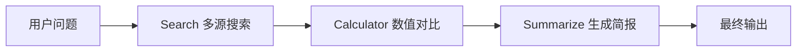

# 第七章习题详解：构建你的 Agent 框架

> 基于教材《第七章 构建你的 Agent 框架》习题，结合正文实现、第六章框架使用经验与本章 `code/chapter7/` 实践，用通俗语言梳理答案与设计思路。  
> 同步写入：`docs/chapter7/第七章 构建你的Agent框架.md` / 学习版 习题各题后。

---

## 习题 1：为何自建框架 & 设计理念

### 1.1 四个局限性如何拖慢开发效率（结合第六章 / 实际经验）

正文 7.1.1 列出的四个痛点，对照第六章用过的 **LangChain / AutoGen / LangGraph / AgentScope** 等，对效率的影响可以这样理解：

| 局限性 | 实际怎么「拖时间」 | 例子 |
|--------|-------------------|------|
| **过度抽象** | 简单任务也要先搞清 Chain / Runnable / AgentExecutor / Tool 等多层概念，调试时堆栈深、报错难定位 | 用 LangChain 做「搜索 + 总结」时，往往要理解 LCEL、Prompt、Retriever、Agent 多套抽象，半天都在对齐接口而不是写业务 |
| **快速迭代 / API 不稳定** | 文档与代码不同步，升级后 import 路径、参数名变更，旧教程直接跑不通 | 第六章跟练时，同一概念在不同版本叫法不同；社区示例「复制即失败」要反复查 changelog |
| **黑盒实现** | 遇到「Agent 死循环 / 工具没被调用」时，看不到内部决策细节，只能猜 Prompt 或翻源码 | AutoGen 群聊跑偏时，若缺乏清晰状态机，只能靠日志猜「谁在什么时候发言」 |
| **依赖复杂** | 安装体积大、传递依赖冲突，和现有项目拼在一起易踩坑 | 一个小 Demo 拉起十几二十个包；与公司内部 SDK 版本冲突时，排依赖比写 Agent 还久 |

**一句话**：主流框架强大，但「学习成本 + 升级成本 + 排错成本」叠加后，短周期学习/教学/定制场景里，自建轻量框架往往更快形成可控闭环。

### 1.2 「万物皆为工具」：优势与局限

**优势**

1. **心智模型统一**：上层只记「Agent 调工具」，Memory / RAG / MCP 都挂成工具，降低概念面。  
2. **扩展成本低**：新能力 ≈ 实现统一接口 + 注册到 `ToolRegistry`，不必再发明一层子系统。  
3. **便于教学与观测**：工具调用天然可打印、可 mock、可写测试（本章 `test_tool_chain_manager.py` 等就是这种思路）。  
4. **组合能力强**：工具链、异步执行器可以直接编排「搜索 → 计算 → 总结」这类流水线。

**局限（举例）**

1. **语义被压扁**：Memory 有生命周期、检索策略、遗忘策略；硬塞成 `execute(str)->str` 会丢失结构化语义。例如「按时间衰减写回长期记忆」用单字符串返回很难表达清楚。  
2. **接口过窄**：复杂模块常需流式、回调、事务；统一成字符串工具会迫使调用方自己做二次解析。  
3. **生命周期不同**：工具偏「无状态一次调用」；MCP 连接、向量库客户端更像「长连接服务」，强行当工具要额外管理连接池/单例。  
4. **权限与安全边界模糊**：把「读库 / 写文件 / 调支付 API」都叫工具，若不加分级授权，Agent 误调的风险更大。

**结论**：教学与中小规模 Agent 很合适；进入生产级记忆/检索/协议层时，仍建议在「工具外观」之下保留独立子系统（第八章 Memory/RAG 就是这种演进）。

### 1.3 第四章脚本 vs 本章框架化；若自建优先哪些原则

**框架化带来的具体改进**

1. **统一入口**：都继承 `Agent`，对外 `run(input)`，历史用 `Message` 管理，而不是各写各的 `while` 脚本。  
2. **LLM / 工具解耦**：`HelloAgentsLLM` + `ToolRegistry` 可替换，范式逻辑不再和某个 API Key、某个 `search()` 函数绑死。  
3. **提示词可配置**：如 ReAct / Reflection 的 `custom_prompt` / `custom_prompts`，同一套代码可服务「通用问答」和「代码审查」。  
4. **可测试、可安装**：有包版本与 examples，比第四章「复制粘贴一整份脚本」更易复现。

**若自己设计框架，优先原则（建议排序）**

1. **接口统一、实现可替换**（开闭原则）  
2. **约定优于配置 + 显式覆盖**（自动检测 + `provider=`）  
3. **可观测**：Thought / Action / Observation 可打印、可落盘  
4. **最小依赖**（教学/嵌入友好）  
5. **安全默认**：工具白名单、超时、最大步数  

---

## 习题 2：HelloAgentsLLM 扩展与本地推理

### 2.1 实践：继承添加新供应商（以 Anthropic / Gemini / 月之暗面 Kimi 为例）

思路对齐 7.2.1 的 `MyLLM`：重写 `__init__`，识别 `provider`，补环境变量与默认 `base_url`；其余交给父类 OpenAI 兼容客户端（多数厂商提供兼容端点或需专用 SDK，教学上可先走兼容网关）。

```python
# my_llm_providers.py
import os
from typing import Optional
from hello_agents import HelloAgentsLLM

class MyLLM(HelloAgentsLLM):
    """扩展 Anthropic / Gemini / Kimi 等提供商（继承 + 自动检测）"""

    def __init__(
        self,
        model: Optional[str] = None,
        api_key: Optional[str] = None,
        base_url: Optional[str] = None,
        provider: Optional[str] = None,
        **kwargs,
    ):
        # 1) 自动检测：优先看专用环境变量
        if provider is None:
            if os.getenv("ANTHROPIC_API_KEY"):
                provider = "anthropic"
            elif os.getenv("GOOGLE_API_KEY") or os.getenv("GEMINI_API_KEY"):
                provider = "gemini"
            elif os.getenv("MOONSHOT_API_KEY") or os.getenv("KIMI_API_KEY"):
                provider = "kimi"

        # 2) 按 provider 补默认凭证与地址（OpenAI 兼容网关示例）
        if provider == "anthropic":
            api_key = api_key or os.getenv("ANTHROPIC_API_KEY") or os.getenv("LLM_API_KEY")
            base_url = base_url or os.getenv("LLM_BASE_URL") or "https://api.anthropic.com/v1/"
            model = model or os.getenv("LLM_MODEL_ID") or "claude-3-5-sonnet-latest"
        elif provider == "gemini":
            api_key = api_key or os.getenv("GEMINI_API_KEY") or os.getenv("GOOGLE_API_KEY")
            base_url = base_url or os.getenv("LLM_BASE_URL") or "https://generativelanguage.googleapis.com/v1beta/openai/"
            model = model or os.getenv("LLM_MODEL_ID") or "gemini-2.0-flash"
        elif provider == "kimi":
            api_key = api_key or os.getenv("MOONSHOT_API_KEY") or os.getenv("KIMI_API_KEY")
            base_url = base_url or os.getenv("LLM_BASE_URL") or "https://api.moonshot.cn/v1"
            model = model or os.getenv("LLM_MODEL_ID") or "moonshot-v1-8k"

        if provider in {"anthropic", "gemini", "kimi"}:
            # 直接走父类「已解析凭证」路径；若父类强制再检测，可按 7.2.1 方式分支
            super().__init__(model=model, api_key=api_key, base_url=base_url, provider=provider, **kwargs)
        else:
            super().__init__(model=model, api_key=api_key, base_url=base_url, provider=provider, **kwargs)
```

使用：在 `.env` 写 `MOONSHOT_API_KEY=...`，然后 `llm = MyLLM()` 即可自动命中 `kimi`。

### 2.2 同时设置 `OPENAI_API_KEY` 与本地 Ollama URL，选谁？

按 7.2.3 优先级：

1. **最高**：特定服务商环境变量（含 `OPENAI_API_KEY`）  
2. **次高**：`LLM_BASE_URL` 特征（`:11434` → ollama）  
3. **辅助**：密钥格式  

因此：**会选择 `openai`，不会选 `ollama`**。  
因为步骤 1 一旦发现 `OPENAI_API_KEY` 就直接 `return "openai"`，根本不会走到解析 `http://localhost:11434/v1` 的逻辑。

**是否合理？**

- **合理之处**：密钥是强意图信号；避免「本机装了 Ollama 默认端口」误伤云端配置。  
- **不合理之处 / 坑**：本地开发常「云端 Key 常驻 + 临时想切 Ollama」，会被 Key 抢优先级，表现为请求打到 OpenAI 默认地址。  

**改进建议**：`provider=` 显式指定永远最高；或增加 `LLM_PROVIDER=ollama`；或「专用 Key 与本地 base_url 冲突时告警」。

### 2.3 VLLM / SGLang / Ollama 对比

**SGLang 是什么**：面向高吞吐推理与复杂 LLM 程序（多轮、Agent、结构化输出）的服务框架；核心能力含连续批处理，以及 **RadixAttention**（按 token 前缀做 KV cache 复用），适合「系统提示 / 长文档 / 工具定义」高度重复的场景。对外通常也提供 OpenAI 兼容 HTTP，可像 vLLM 一样挂进 `HelloAgentsLLM`。

| 维度 | Ollama | vLLM | SGLang |
|------|--------|------|--------|
| **易用性** | 最好：`ollama pull` + 本地 API，适合个人本机 | 中等：需部署服务、配 GPU/模型路径 | 中等偏工程：偏生产与复杂工作流 |
| **资源占用** | 本机友好，CPU/GPU 混合；单机单用户为主 | GPU 显存吃得紧但利用率高（PagedAttention） | 与 vLLM 同级；前缀共享多时可更省重复 KV |
| **推理速度 / 吞吐** | 单用户够用；高并发弱 | 生产吞吐常为默认首选 | 高前缀复用（多轮/RAG/Agent）时往往优于或接近 vLLM |
| **推理精度** | 取决于量化与模型本身，引擎不「改变智商」 | 同左 | 同左；差异主要在延迟/吞吐与缓存策略，而非神秘提分 |

**选型口诀**：本机试玩 → Ollama；多用户通用吞吐 → vLLM；多轮/Agent/共享前缀重 → 重点评估 SGLang。

---

## 习题 3：Message / Config / Agent

### 3.1 Message 用 Pydantic 的优势

1. **自动校验**：`role` 用 `Literal` 限制取值，非法角色直接报错，避免脏数据进历史。  
2. **类型提示友好**：IDE / mypy 更好用，减少 `dict` 拼写错误。  
3. **序列化方便**：`model_dump()` / `to_dict()` 对齐 OpenAI messages 格式。  
4. **扩展位清晰**：`metadata`、`timestamp` 有类型约束，后续做审计、分支对话时不易失控。  
5. **文档即契约**：字段定义本身就是接口说明。

### 3.2 `run` + `_execute`：模板方法模式（Template Method）

这是经典的 **模板方法模式**：基类定义算法骨架（`run`：记历史、打日志、异常处理、调用核心步骤），把可变部分留给子类抽象方法（`_execute`）。

**好处**

- 公共流程只写一次（开闭原则）  
- 子类专注「怎么思考/行动」，不重复样板代码  
- 对外 API 稳定（永远调 `run`），内部可演进  

> **与正文对照**：7.3.3 示例把抽象点直接放在 `run` 上；习题描述的 `run`/`_execute` 拆分是更完整的模板方法写法，工业代码里更常见。

### 3.3 单例模式与配置管理

**单例**：保证一个进程内某类只有一个实例，并提供全局访问点。

**配置为何常谈单例**

- 温度、debug、默认模型等应全局一致  
- 避免 A 模块 `temperature=0.2`、B 模块又 `Config()` 成 `0.7`  

**不用单例可能的问题**

- 多份配置互相覆盖、行为难复现  
- 热更新只改到其中一份  
- 测试与生产配置串味  

> **与正文对照**：7.3.2 给出的是普通 Pydantic `Config` + `from_env()`，**并未强制单例**。答题重点是「配置一致性」；实现上可用单例，也可用依赖注入同一 `Config` 实例（往往更利于测试）。

---

## 习题 4：Agent 范式框架化

### 4.1 第四章 ReAct vs 本章框架化：3 个改进点

1. **接入 `ToolRegistry`**：工具增删改注册即可，不必改 Agent 内部 `if tool_name == ...`。→ 可扩展性 ↑  
2. **提示词模板化 + 可覆盖**：`MY_REACT_PROMPT` / `custom_prompt`，格式约束更严（每次一步、Finish 语义清晰）。→ 可维护性 ↑  
3. **统一生命周期与历史**：继承框架 Agent，用 `Message` 记录问答；`max_steps` 等配置化。→ 可测试、可观测 ↑  

### 4.2 Reflection + 质量评分早停（扩展思路）

在「initial → reflect → refine」循环中插入 **score**：

```python
SCORE_PROMPT = """请对下面回答打分（0-10 的整数），只输出数字。
任务: {task}
回答: {content}
评分标准: 正确性、完整性、清晰度。
分数:"""

def run(self, task: str, max_iterations: int = 3, score_threshold: float = 9.0) -> str:
    content = self.llm.invoke([{"role": "user", "content": self.prompts["initial"].format(task=task)}])
    for i in range(max_iterations):
        feedback = self.llm.invoke([{"role": "user", "content": self.prompts["reflect"].format(task=task, content=content)}])
        if "无需改进" in feedback:
            break
        score_text = self.llm.invoke([{"role": "user", "content": SCORE_PROMPT.format(task=task, content=content)}])
        try:
            score = float("".join(ch for ch in score_text if ch.isdigit() or ch == ".") or "0")
        except ValueError:
            score = 0
        if score >= score_threshold:
            break  # 已足够好，提前终止
        content = self.llm.invoke([{
            "role": "user",
            "content": self.prompts["refine"].format(task=task, last_attempt=content, feedback=feedback),
        }])
    return content
```

要点：阈值可配；打分失败要有兜底；避免「为了迭代而迭代」浪费 token。

### 4.3 Tree-of-Thought Agent 设计要点

继承 `Agent`，每步：

1. **Expand**：让 LLM 生成 k 条候选 Thought  
2. **Evaluate**：对候选打分 / 投票 / 启发式评估  
3. **Select**：选最优继续，直到给出 Final Answer 或达到深度上限  

```python
class TreeOfThoughtAgent(Agent):
    def run(self, input_text: str, breadth: int = 3, max_depth: int = 4, **kwargs) -> str:
        state = input_text
        for depth in range(max_depth):
            candidates = self._expand(state, breadth)          # 生成多条路径
            best = self._select(input_text, candidates)        # 选最优
            if self._is_final(best):
                self.add_message(Message(input_text, "user"))
                self.add_message(Message(best, "assistant"))
                return best
            state = best
        return state
```

可与工具结合：某条路径需要检索时再调 `ToolRegistry`。注意控制 `breadth * depth` 的调用成本。

---

## 习题 5：工具系统

### 5.1 为何统一 `execute`/`run`？多值结果怎么设计？

**统一接口的原因**：注册表、工具链、Agent 才能无差别调度；符合里氏替换与依赖倒置；测试可统一 mock。

**多值返回建议**（在「对外仍是 str / 结构化对象」的前提下）：

1. **返回 JSON 字符串**（与当前教学实现最契合）：  
   `{"title": "...", "snippet": "...", "url": "..."}`  
2. **返回 dict / Pydantic 模型**，由 Registry 层统一 `json.dumps`  
3. **主返回摘要 str + `metadata`**（类似 Message.metadata）供程序消费  

不要为每个工具发明互不兼容的返回类型，否则工具链无法通用。

### 5.2 实际场景：至少 3 工具串联 + 流程图

**场景：技术调研简报**（与正文 `research_and_calculate` 同构，换成业务语义）

1. `advanced_search`：搜「某框架最新版本与变更」  
2. `calculator`：根据文档中的性能数字做对比计算  
3. `summarizer`（或再调 LLM 工具）：生成中文要点简报  



上下文用 `output_key` 传递：`{search_result}` → `{calc_result}` → 最终总结。

### 5.3 何时并行能提速？

**能提速（I/O 密集、相互独立）**

- 同时查 Tavily + SerpAPI  
- 并行抓多个 URL  
- 互不依赖的多个只读工具  

**难提速 / 反而有害**

- 后一步依赖前一步输出（必须串工具链）  
- 纯 CPU 重且受 GIL 限制的计算（线程池收益有限）  
- 共享有配额的 API（并行触发限流）  

经验法则：**无数据依赖的 I/O 等待 → 并行；有依赖 → 工具链串行。**

---

## 习题 6：流式输出 / 多轮对话 / 插件系统

> 可运行实现（均继承原有 Agent，避免重复造轮子）：
>
> | 能力 | 代码 | 测试 |
> |------|------|------|
> | 流式输出 | `code/chapter7/my_streaming_agent.py`（`StreamingAgent(MySimpleAgent)`）+ `stream_events.py` | `test_streaming_agent.py` |
> | 多轮对话 | `code/chapter7/conversation.py` + `my_dialog_agent.py`（`DialogAgent(MySimpleAgent)`） | `test_dialog_agent.py` |
> | 插件系统 | `code/chapter7/plugin_system.py` + `plugins/demo_plugins.py`（`EchoAgent(SimpleAgent)`） | `test_plugin_system.py` |
>
> 测试通过 `__file__` 加载同目录 `.env`，调用真实 `HelloAgentsLLM`。在 `code/chapter7/` 下执行对应 `test_*.py` 即可。

### 6.1 流式输出方案

| 层级 | 改动 |
|------|------|
| `HelloAgentsLLM` | 已有/`think` 流式；补齐统一 `stream(messages) -> Iterator[str]` |
| `Agent` 基类 | 增加 `stream(input_text) -> Iterator[str]`；默认可「非流式拼完再 yield 一次」 |
| `SimpleAgent` | `run` 调 `invoke`；`stream` 调 `llm.think/stream`，边生成边 yield |
| `ReActAgent` 等 | Thought/Action 可按步 yield 状态事件；最终答案再流式输出 |
| 可选 | 定义 `StreamEvent(type, data)`：`token` / `tool_start` / `tool_result` / `final` |

**本仓库落地**：`StreamingAgent` 继承 `MySimpleAgent`，新增 `stream() -> Iterator[StreamEvent]`；`stream_run()` 只透传 `token` 做打字机；无 `stream_invoke` 时降级为整段 yield。

UI 层订阅 iterator 即可做「打字机」效果。

### 6.2 多轮对话管理

**新增类建议**

- `Conversation`：一次会话，含 `id`、`messages: list[Message]`、`created_at`  
- `ConversationStore`：内存/磁盘读写  
- `DialogTree` / `Checkpoint`：每个分支节点保存到该步为止的 Message 快照  

**与 Message 集成**

- 叶子仍是 `Message`（`metadata.message_id` 用于定位）  
- 分支 = 从某 `message_id` / checkpoint 复制前缀历史再继续 append  
- 回溯 = 把 Agent 的 `_history` 重置为某 checkpoint 的拷贝  

**本仓库落地**：`DialogAgent` 继承 `MySimpleAgent`，每轮 `run` 后自动 `checkpoint`；`rollback` / `branch` 只重置父类历史，不维护第二份消息列表。

Agent 不直接管树，只消费「当前分支的 Message 列表」。

### 6.3 插件系统架构与关键接口

```text
┌─────────────────────────────────────────┐
│              HelloAgents Core           │
│  Agent ABC · ToolRegistry · LLM · Config│
└───────────────┬─────────────────────────┘
                │ PluginAPI / hooks
        ┌───────┴────────┐
        │  PluginManager │  discover → load → register → unload
        └───────┬────────┘
     ┌──────────┼──────────┐
     ▼          ▼          ▼
 AgentPlugin  ToolPlugin  ProviderPlugin
 (注册范式)   (注册工具)   (注册模型供应商)
```

**关键接口（示意）**

```python
class Plugin(Protocol):
    name: str
    version: str
    def setup(self, app: "HelloAgentsApp") -> None: ...
    def teardown(self) -> None: ...

class HelloAgentsApp:
    def register_agent_type(self, name: str, cls: type[Agent]) -> None: ...
    def register_tool(self, tool: Tool) -> None: ...
    def register_provider(self, name: str, factory: Callable) -> None: ...
```

**本仓库落地**：`register_agent_type` 强制 `issubclass(cls, Agent)`；示例 `EchoAgent(SimpleAgent)` 由 `EchoAgentPlugin` 注册，无需改框架核心。

发现方式：入口点（`pyproject.toml` entry_points）、约定目录 `plugins/`、或显式 `load_plugin("pkg.mod:Plugin")`。  
原则：**第三方只依赖稳定 PluginAPI，不 patch 核心源码**。

---

## 自检小结

| 题号 | 核心结论 |
|------|----------|
| 1 | 主流框架的抽象/变更/黑盒/依赖会拖慢学习与定制；万物皆工具利教学也有表达力上限 |
| 2 | 同时有 OpenAI Key 与 Ollama URL 时选 **openai**；本机试玩 Ollama，生产看 vLLM/SGLang |
| 3 | Pydantic 强校验；`run`/`_execute` 是模板方法；配置要全局一致（单例或注入同一实例） |
| 4 | 框架化靠 Registry/模板/统一生命周期；Reflection 可加评分早停；ToT = 扩展-评估-选择 |
| 5 | 统一接口换可组合性；多值用 JSON；独立 I/O 才并行 |
| 6 | 流式贯穿 LLM→Agent；对话树管分支；插件用注册钩子扩展 |

**[结论]**：第七章习题强调的是「能解释设计取舍，并能按开闭原则扩展框架」，而不是背 API 名称。
